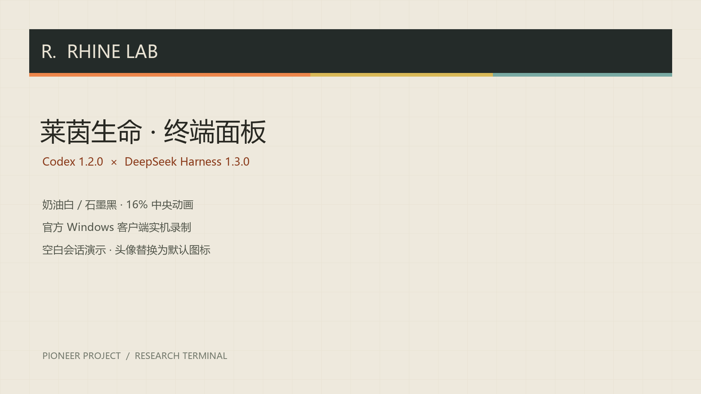

# Codex / DeepSeek Harness 完整介绍

[演示发布页](https://github.com/Galaxy-2001/Rhine-Lab-Codex-Theme/releases/tag/demo-2026-10-12)

104 秒，1920×1080，30 fps，H.264 视频 + AAC 双声道配乐。画面已包含中文字幕，发布页同时提供独立 SRT 字幕。

## 下载

- [介绍视频 MP4](https://github.com/Galaxy-2001/Rhine-Lab-Codex-Theme/releases/download/demo-2026-10-12/Rhine-Lab-Full-Demo-1080p.mp4)
- [单文件离线 HTML 演示](https://github.com/Galaxy-2001/Rhine-Lab-Codex-Theme/releases/download/demo-2026-10-12/Rhine-Lab-Full-Demo.html)
- [1920×1080 封面](https://github.com/Galaxy-2001/Rhine-Lab-Codex-Theme/releases/download/demo-2026-10-12/Rhine-Lab-Full-Demo-Cover.png)
- [中文字幕 SRT](https://github.com/Galaxy-2001/Rhine-Lab-Codex-Theme/releases/download/demo-2026-10-12/Rhine-Lab-Full-Demo.zh-CN.srt)
- [配乐许可](https://github.com/Galaxy-2001/Rhine-Lab-Codex-Theme/releases/download/demo-2026-10-12/Music-LICENSE.txt)
- [SHA-256 校验值](https://github.com/Galaxy-2001/Rhine-Lab-Codex-Theme/releases/download/demo-2026-10-12/SHA256SUMS.txt)

下载 HTML 后用浏览器打开，无需安装服务或联网加载素材。将鼠标移到左下角可显示播放、暂停、配乐与章节选择；空格播放/暂停，左右方向键切换章节。音乐需要用户点击后开始播放。

这是主题介绍用的 HTML 展示，不是 DSH 网页服务，也不是主题安装包。

## 内容与版本范围

| 时间 | 内容 |
| --- | --- |
| 00:00 | 双客户端主题介绍 |
| 00:06 | 完整中央立体动画循环 |
| 00:20 | Codex 浅色聊天 |
| 00:31 | Codex 深色聊天与侧栏宽度展示 |
| 00:40 | Codex 设置背景 |
| 00:47 | DSH 浅色聊天 |
| 00:58 | DSH 深色聊天与提示框 |
| 01:09 | DSH 计费插件时段配色 |
| 01:17 | DSH 皮肤与设置 |
| 01:25 | 两种安装方式 |
| 01:36 | 开源项目与使用声明 |

中央动画使用项目现有 SVG：折片自转、同一轮廓压平、正号放大并旋转、减号横向展开、循环缺口。画面采用虚构会话、项目、文件、账户与计费数据，完整展示界面，没有录入私人会话或登录信息。布局与控件由 HTML 绘制，非客户端操作或安装过程实录。

视频包含当前本机的 DSH 深色文字/卡片配色修复，以及计费插件高峰橙色、平价蓝色加斜纹、周末绿色的区分。这些修复现已包含在 DSH 1.2.1 Release 中。当前安装包为 Codex 1.1.1 / DSH 1.2.1，安装方式请参考各自发布说明。

## 配乐与声明

配乐：**Observatory / 观测室 — LBEILC**（MIT）。本次复用此前有许可的配乐片段，做循环、音量调整与首尾淡入淡出；没有提取 B 站参考视频的音轨。

- [配乐项目来源](https://github.com/LBEILC/RhineLabUI/tree/main/public/audio)
- [原项目许可](https://github.com/LBEILC/RhineLabUI/blob/main/LICENSE)
- [随演示保留的完整配乐许可](media/demo-music-LICENSE.txt)

完整许可也保存在 HTML 注释和视频元数据中。

本项目为非官方同人项目，仅供个人学习与交流。相关名称、标志等权利归各自权利人所有。动画为代码重制，非官方视频剪辑或逐帧复刻。

## 检查

离线演示的全部章节已检查图片加载、文字与卡片布局、浅深切换。视频按浏览器帧时间录制，导出时转换为 BT.709 视频色彩范围；完整解码检查通过，成片浅色背景与原页面的 RGB 差异不超过 3 个色阶。MP4、HTML 与附属文件在发布页提供 SHA-256 校验值。
