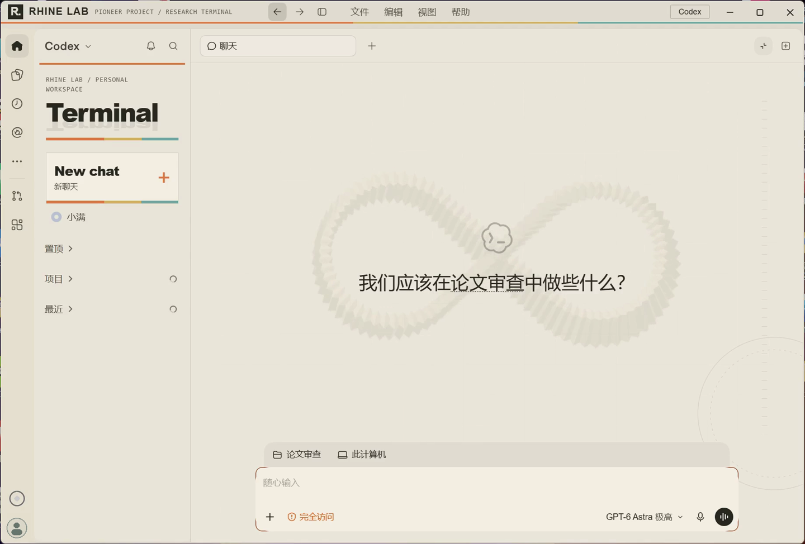
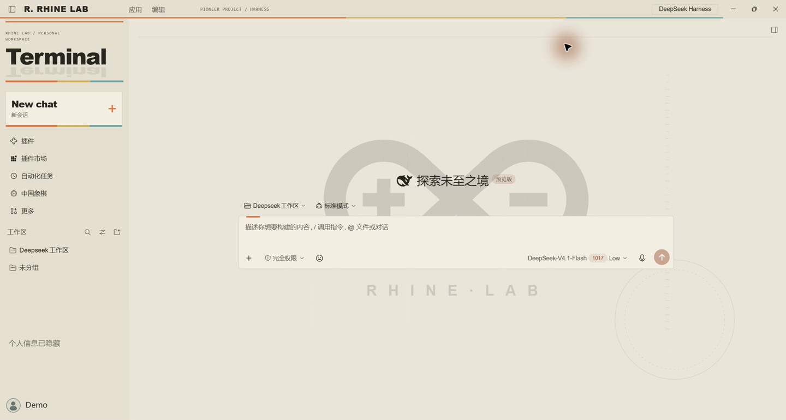

# Pioneer 终端面板

Codex 1.2.2 / DeepSeek Harness 1.3.2，2026-11-23。

- 奶油白与石墨黑、暖色面板与莱茵橙。侧栏原生入口不改尺寸、位置、图标和快捷键提示：新聊天只换底色、细描边与底部 2px 三色边，图标染为莱茵橙。Terminal 站牌画在会话列表的背景底部，列表下方有空位时完整显示，列表放满时退为约 9% 的淡水印。橙 / 黄 / 青三色细边只用于标题栏、新聊天与站牌。标题与标签使用 Windows 自带的 Bahnschrift。
- 顶栏保留原生菜单、窗口按钮和拖动区，加入 RHINE LAB 与客户端名称。浅深模式分别与 Windows 原生窗口按钮统一底色；DeepSeek Harness 完整拼写，小窗口隐藏装饰以保留操作空间。
- Codex 原生聊天标题下增加 32px 任务标签行，正文同步预留空间。输入框外框和主聊天宽度保持原样。
- 中央水印浅色为 **16%**；深色按亮度对比降为折片 8% / 平面 12%，两种模式观感一致。透明度仅作用于素材，正文、卡片和聊天容器保持 opacity 1，没有整页滤镜。
- 保留折片自转、光照阴影、同轮廓压平、循环缺口、正号旋转放大和减号横向展开；全部由代码生成。
- 折片动画只在空白新聊天页播放，已有消息的对话显示静态标志。聊天页使用水印、44px 平铺网格与右侧固定尺寸刻度；设置页只保留网格与刻度。静态层不使用 SVG 遮罩，避免随动画每帧重绘。装饰不接收鼠标事件。DeepSeek Harness 保留原生品牌、新会话图标和侧栏开关。

## 实际客户端

两端仍使用各自原生界面、设置导航与交互。Codex 使用已验证的主题入口；DeepSeek Harness 使用官方插件管理器和皮肤中心，没有修改宿主程序。

## 生成与验证

根目录执行 `npm run generate`（即 `generate-pioneer.mjs` 与 `generate-watermark.mjs`，只写 Codex 素材）；DSH 目录执行 `npm run generate`。安装包携带生成结果，无需用户运行生成器。

`tests/pioneer.test.mjs` 检查 Codex 原生层级、重复应用、移除与布局。`dsh/tests/native-chrome.test.mjs` 使用皮肤中心转换后的 CSS 检查浅深模式、宽窄窗口、侧栏收起 / 展开、输入框点击与 Windows 标题栏读取的 body 色值。

实际桌面验证覆盖官方 Codex 26.1023.6621.0 与 DeepSeek Harness 0.2.1-rc.3 的浅深模式、设置页、标题栏和背景动画。网页夹具与实际客户端检查分别记录在两端验证文档中；未宣称在第二台电脑验证。
