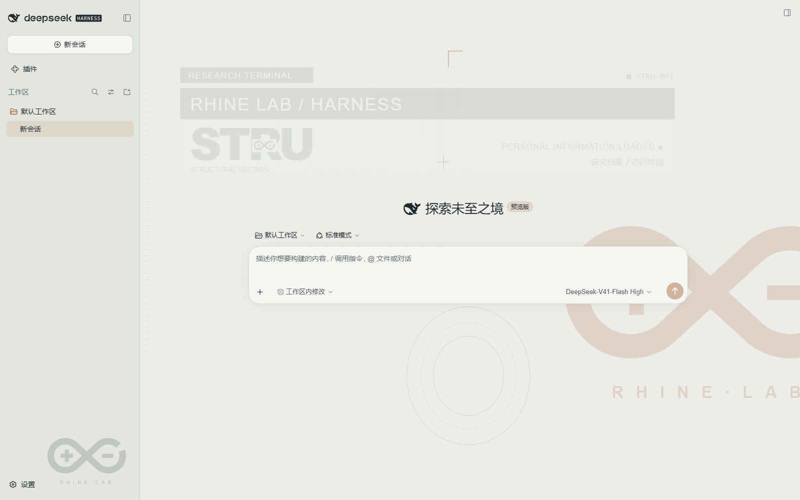
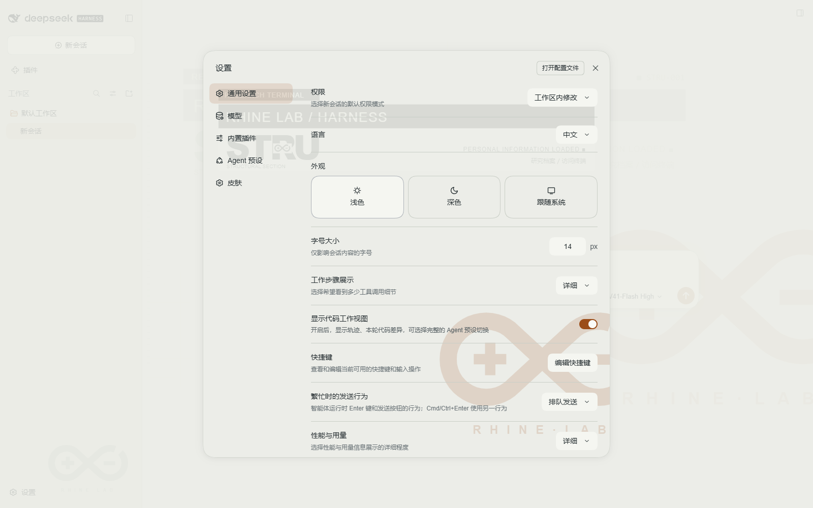

# 莱茵生命 DSH 主题

将莱茵生命 Codex 主题移植到 DeepSeek Harness。保留暖灰浅色、橙色标志、沿轮廓循环的缺口与 STRU 档案水印，也提供深色配色。聊天、设置和左右侧栏使用同一套素材；背景不占布局空间。

本项目提供可安装的 DSH 插件 `dsh-plugin-rhine-lab-theme`。插件自带主题素材，依赖 [dsh-skins](https://github.com/zhu1090093659/dsh-skins) 皮肤中心；首次启用会自动安装素材并选中莱茵生命。后续启动保留你在皮肤中心做的选择。





## 安装

下载 [DSH 1.1.1 发布包](https://github.com/Galaxy-2001/Rhine-Lab-Codex-Theme/releases/tag/dsh-v1.1.1)。桌面版选用 `dsh-plugin-rhine-lab-theme-1.1.1.tgz`；Skin ZIP 用于已有皮肤中心的手动安装，Source ZIP 用于开发。

### 官方桌面客户端（推荐）

1. 下载 Release 中的 `dsh-plugin-rhine-lab-theme-1.1.1.tgz`，保持压缩包原样。
2. 打开官方 DSH 桌面版，在“插件 → 添加插件”输入这个文件的完整绝对路径，例如 `C:\Downloads\dsh-plugin-rhine-lab-theme-1.1.1.tgz`。
3. 点击安装，完成后点击“立即启用”。客户端会安装依赖，首次启用自动应用主题。日常仍从原来的 DSH 图标打开。

首次安装需要联网下载皮肤中心依赖。如果客户端提示重新加载，按其提示操作。这个包尚未发布到 npm，不能直接按包名从注册表安装。不要用普通 CLI 改写保留的 desktop profile。

### 网页版

```powershell
dsh plugin --profile web add "C:\Downloads\dsh-plugin-rhine-lab-theme-1.1.1.tgz"
dsh web
```

如果网页服务已经运行，安装插件后按 DSH 提示重新加载或重启服务。`127.0.0.1:3080` 拒绝连接表示服务没有启动，先运行 `dsh web`；安装主题本身不会让网页服务常驻。

### 只安装皮肤素材

已经安装皮肤中心、希望手动选择主题时：

1. 将 Skin ZIP 中的 `rhine-lab` 文件夹放到 `$DSH_HOME/skins/`。默认位置是用户目录下 `.dsh/skins/rhine-lab`。
2. 打开 DSH 设置中的“皮肤中心”，刷新列表，选择“莱茵生命”并应用。
3. 日常从原来的 DSH 入口启动，选择会由皮肤中心保存。

也可以完整解压 Source ZIP，双击“安装莱茵主题.cmd”。这个入口需要 Node.js，只复制皮肤；重复安装会备份上一版。它尊重 `DSH_SKINS_HOME`、`DSH_SKINS_DIR` 和 `DSH_HOME`。

单独安装皮肤中心的命令仍然可用：

```powershell
dsh plugin --profile web add @linxin666/dsh-client-ui-skin-center@0.4.5
```

源码包的“安装皮肤中心-Web.cmd”执行同一命令。完整插件包已经声明该依赖，不需要再手工安装一次。

## 兼容性

目标契约为皮肤中心 0.4.5 的 `skinManifestVersion: 2`、L1 设计 token 和 L2 语义属性。皮肤目录只含 JSON、CSS 和本地 SVG/预览素材，不运行 hooks。

目标为 DSH 0.2.0-rc.2、皮肤中心 0.4.5。DSH 的运行时检查包含预发行版本，无需豁免。开发依赖固定为 0.1.7-rc.1，是为了避免 npm 默认 peer 解析排除 0.2 预发行版；使用主题不需要降级 DSH。具体实测范围见验证记录。

动画周期为六秒。系统启用“减少动态效果”时 SVG 停止循环。背景遮罩、模糊与开关由皮肤中心管理；外部壁纸启用时按加载器规则让出背景。

## 恢复

在皮肤中心应用“官方默认”或另一款皮肤即可恢复，后续启动不会重新强制选择莱茵生命。在 DSH 插件页可以停用或卸载插件。要清理素材，先切回官方默认，再在皮肤中心卸载莱茵生命。更新备份放在 `.dsh/rhine-lab-backups/`，不会混入皮肤列表。

## 开发与打包

```powershell
npm ci --ignore-scripts
npm test
npm run build
```

`dist` 生成可安装的插件 TGZ、Skin ZIP、Source ZIP 和 `SHA256SUMS.txt`。Source ZIP 包含插件代码、素材、安装脚本与测试；TGZ 可直接交给 DSH 插件管理器安装。实测范围见 [验证记录](docs/VALIDATION.md)。本项目尚未收录到 DSH 创意工坊。

## 许可

主题代码使用 MIT 许可。莱茵生命及相关标志属于《明日方舟》权利方，此为非官方同人主题，代码许可不包含品牌授权。见 [来源说明](THIRD_PARTY_NOTICES.md)。
