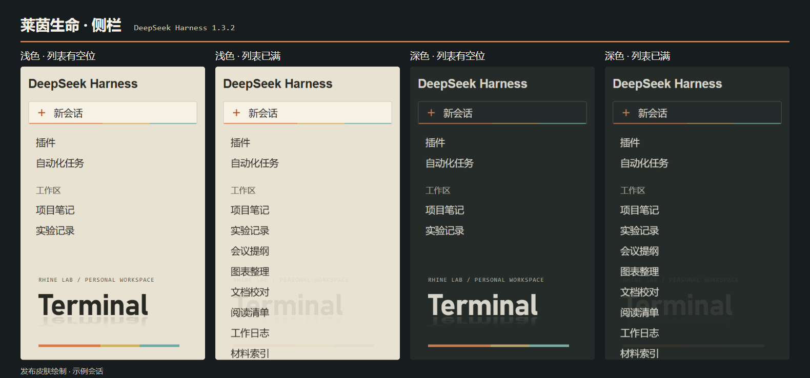

# 莱茵生命 DSH 主题 1.3.2

新会话、插件和自动化任务沿用 DSH 原生尺寸与点击区域。Terminal 从侧栏顶部移到会话列表底部。下方有空位时显示完整站牌和倒影；列表变长或窗口拉矮时退为 9% 的淡水印。较早的客户端使用淡水印。

桌面用户在「插件 → 添加插件」选择 `dsh-plugin-rhine-lab-theme-1.3.2.tgz`。Skin ZIP 供皮肤中心手动安装，Source ZIP 包含源码与测试。升级会保留原有皮肤和背景选择。

[安装说明](https://github.com/Galaxy-2001/Rhine-Lab-Codex-Theme/tree/dsh-v1.3.2/dsh) · [验证记录](https://github.com/Galaxy-2001/Rhine-Lab-Codex-Theme/blob/dsh-v1.3.2/dsh/docs/VALIDATION.md)
